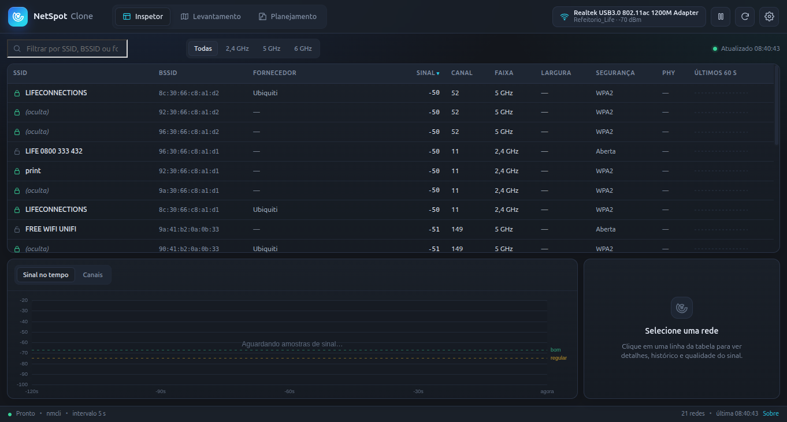
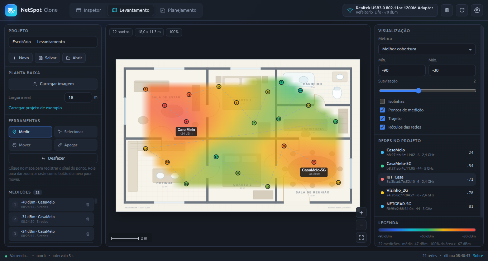
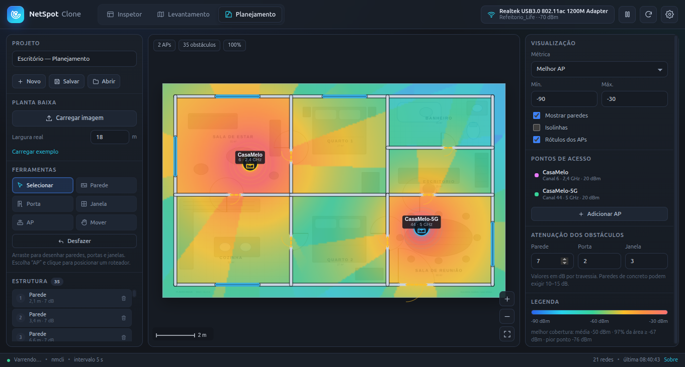

# NetSpot Clone

Analisador e planejador de redes Wi-Fi para Windows e Linux, com interface em português (pt-BR), tema escuro por padrão e opção de tema claro. Este projeto é uma **reimplementação independente**, criada a partir da análise de comportamento e de evidências extraídas do aplicativo original; não contém código, binários, ícones ou outros assets proprietários do NetSpot.

> **Aviso legal:** este software não é afiliado, associado, autorizado ou endossado pela NetSpot Pty Ltd. “NetSpot” é marca de seus respectivos proprietários e é usada aqui apenas para descrever a finalidade do projeto. O uso do nome não implica qualquer vínculo.

## Capturas

| Inspetor | Levantamento | Planejamento |
| --- | --- | --- |
|  |  |  |

## Recursos

### Inspetor
- Lista de redes próximas com SSID, BSSID, canal, faixa, largura de canal, segurança, fabricante (OUI), RSSI e SNR.
- Busca por SSID/BSSID/fabricante, filtros por faixa (2,4/5/6 GHz), ordenação por coluna e tabela com seleção de rede.
- Painel de detalhes com gráfico de histórico de sinal e gráfico de ocupação de canais.
- Atualização automática da varredura, com pausa/retomada e contador de redes.

### Levantamento (Survey)
- Mapa de planta com pontos de medição, arraste e zoom.
- Mapa de calor por cobertura, RSSI por AP, contagem de redes e interferência.
- Máscara por contorno convexo, interpolação IDW, suavização e isolinhas.
- Régua de escala, rótulos de ambiente e legenda de cores.
- Inclusão, seleção e remoção de pontos, com desfazer.
- Estatísticas: sinal médio, área acima do limite, pontos coletados e interferência.
- Exportação de CSV, PNG e relatório PDF.
- Plantas e projetos de exemplo para começar rapidamente.

### Planejamento (Predictive)
- Desenho de paredes, portas e janelas diretamente na planta.
- Cadastro, arraste, edição e remoção de pontos de acesso.
- Simulação de cobertura com modelo log-distância e atenuação por obstáculos.
- Mapa de calor, isolinhas e estimativa de alcance.
- Desfazer e salvamento/abertura de projeto.

### Aparência e produtividade
- Tema escuro (padrão) e tema claro.
- Atalhos de teclado para troca de telas e ferramentas.
- Salvamento e abertura de projetos em JSON.
- Diálogos de configurações e sobre.

## Requisitos

### Linux
- Distribuição x86_64 com ambiente gráfico (X11 ou Wayland via XWayland).
- Adaptador Wi-Fi interno ou USB reconhecido pelo sistema.
- Para varredura: `nmcli` (NetworkManager) ou `iw`.
- Para resultados completos com `iw`, execute com privilégios suficientes para acesso ao adaptador (por exemplo, `sudo`); sem isso, o aplicativo usa o `nmcli` como fonte principal.

### Windows
- Windows 10/11 x64.
- Serviço **WLAN AutoConfig** (`WlanSvc`) ativo.
- O aplicativo usa `netsh wlan` e, quando disponível, um auxiliar PowerShell que consulta `wlanapi.dll` para obter dados adicionais. Se o auxiliar não puder ser executado, a varredura continua pelo `netsh`.

## Executar a partir do código

```bash
npm install
npm start
```

A tela **Inspetor** usa sempre o adaptador Wi-Fi real do computador (placa interna ou adaptador USB). Não há modo de demonstração: se nenhuma rede aparecer, o aplicativo mostra o diagnóstico do adaptador e instruções para corrigir o problema.

### Teste rápido em ambiente sem display

```bash
npm run smoke
```

Gera uma captura em `/tmp/netspot-clone.png` usando `xvfb-run`.

## Gerar os pacotes

```bash
npm run package:all
```

Saídas:

- `dist/NetSpot-win32-x64/NetSpot.exe`
- `dist/NetSpot-linux-x64/NetSpot`

Para gerar apenas uma plataforma:

```bash
npm run package:win
npm run package:linux
```

Os pacotes usam Electron 45 e são produzidos com `@electron/packager`. Não há etapa de build/transpilação: o código em `src/` é carregado diretamente.

## Uso

1. Abra o aplicativo e escolha **Inspetor** para ver as redes ao redor.
2. Em **Levantamento**, abra um projeto de exemplo ou importe uma planta e adicione pontos de medição.
3. Use as abas de métrica para alternar entre cobertura, RSSI por AP, número de redes e interferência.
4. Exporte o resultado em CSV, PNG ou PDF.
5. Em **Planejamento**, desenhe obstáculos, posicione APs e execute a simulação para avaliar a cobertura prevista.

Consulte o menu **Configurações** para tema, intervalo de varredura e limites de sinal. O menu **Sobre** mostra versão e informações do projeto.

## Estrutura do projeto

```
src/
  main.js                 processo principal do Electron e IPC
  preload.js              ponte segura entre renderer e main
  scanner/
    index.js              orquestração da varredura e histórico
    windows.js            varredura via netsh wlan
    wlanapi.js            auxiliar PowerShell/wlanapi.dll
    wlan-helper.ps1       script auxiliar do Windows
    linux.js              varredura via nmcli/iw
    util.js               normalização, canais, OUI etc.
  renderer/
    index.html            estrutura da interface
    styles.css            temas e layout
    app.js                estado, eventos e exportações
    map.js                motor de mapa, ferramentas e mapas de calor
    heatmap.js            IDW, máscara, isolinhas
    sim.js                modelo de propagação e atenuação
    charts.js             gráficos de histórico e canais
    sample.js             plantas e dados de exemplo
assets/
  icon.png, icon.ico      ícones do aplicativo
  oui.json                base de fabricantes por OUI
```

## Limitações conhecidas

- A varredura depende do sistema operacional e do adaptador. Alguns adaptadores/drivers não expõem BSSID, largura de canal ou RSSI por rede; nesses casos os campos aparecem como indisponíveis.
- No Linux, a varredura com `iw` pode exigir privilégios de root. O aplicativo tenta `nmcli` primeiro e recorre a `iw` quando necessário.
- No Windows, o auxiliar PowerShell pode ser bloqueado por políticas de execução; o `netsh` permanece como fallback.
- O modelo de planejamento é uma estimativa. Paredes, portas e janelas usam atenuações típicas e não substituem uma medição real.
- Os mapas de calor são interpolados a partir dos pontos coletados; a precisão aumenta com a densidade de medições.
- O aplicativo não coleta nem envia dados para servidores externos.

## Evidências da análise

A reimplementação foi guiada por análise de engenharia reversa do instalador e do aplicativo original, incluindo:

- identificação do empacotador Inno Setup e extração do conteúdo;
- análise da aplicação .NET/WPF e de seus assemblies;
- levantamento de telas, fluxos, formatos de projeto e faixas de RSSI;
- estudo do comportamento de varredura e das métricas de cobertura/interferência.

Os artefatos de análise foram mantidos fora dos pacotes entregues. Nenhum arquivo proprietário é redistribuído.

## Licença

MIT. Consulte [LICENSE](LICENSE).

Copyright © 2026 NetSpot Clone Project.
